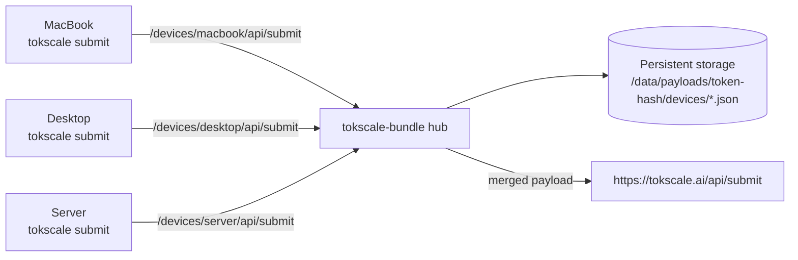
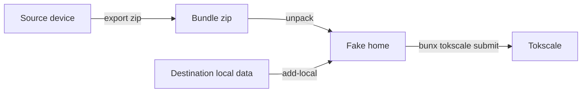

# tokscale-bundle

`tokscale-bundle` runs a small Tokscale payload hub so multiple devices can submit one combined Tokscale profile.

Each device still runs the official `tokscale submit`. The only change is `TOKSCALE_API_URL`: it points to this hub with a stable device id. The hub stores the latest submit payload for each device, merges them, and forwards the merged payload to Tokscale.

## Flow



## Docker

Build:

```bash
git clone --recurse-submodules https://github.com/gigio1023/tokscale-bundle.git
cd tokscale-bundle
docker build -t tokscale-bundle .
```

Run with a named volume:

```bash
docker volume create tokscale-bundle-data

docker run -d \
  --name tokscale-bundle \
  --restart unless-stopped \
  -p 4787:4787 \
  -v tokscale-bundle-data:/data \
  tokscale-bundle
```

Or bind a host directory:

```bash
mkdir -p "$HOME/.local/share/tokscale-bundle"

docker run -d \
  --name tokscale-bundle \
  --restart unless-stopped \
  -p 4787:4787 \
  -v "$HOME/.local/share/tokscale-bundle:/data" \
  tokscale-bundle
```

The container defaults to:

```bash
tokscale-bundle serve --bind 0.0.0.0:4787 --storage /data --submit
```

State survives container stops and rebuilds as long as `/data` is backed by the same Docker volume or host directory.

## Direct Run

```bash
cargo run -- serve \
  --bind 0.0.0.0:4787 \
  --storage /var/lib/tokscale-bundle \
  --submit
```

Direct and Docker modes are compatible. Use the same storage directory to move between them.

## Device Submit

All devices you want to merge must use the same Tokscale credential:

```text
~/.config/tokscale/credentials.json
```

That file is written by `tokscale login` and contains the bearer token used by `tokscale submit`. Copy or otherwise keep the same `credentials.json` on every device that should be part of the same combined profile.

Then use a unique, stable device id in the URL path:

```bash
export TOKSCALE_API_URL="https://your-server.example.com/devices/macbook-pro"
bunx tokscale@latest submit
```

Examples:

```bash
export TOKSCALE_API_URL="https://your-server.example.com/devices/macbook-pro"
export TOKSCALE_API_URL="https://your-server.example.com/devices/desktop"
export TOKSCALE_API_URL="https://your-server.example.com/devices/server"
```

Do not point every device at the bare server URL. Official Tokscale does not send a device id header, so bare `/api/submit` stores everything as `default` and devices overwrite each other.

## Storage

Payload proxy state is stored as files:

```text
<storage>/payloads/<tokscale-token-hash>/devices/<device-id>.json
```

The Tokscale token is the merge namespace. Device id only separates machines inside that namespace:

- same Tokscale token + same device id: updates the existing device file
- same Tokscale token + new device id: adds another device
- new Tokscale token: creates a separate token-hash namespace

If one device submits through the proxy with a different Tokscale token, it will not merge with the others. With `--submit`, that separate token namespace can be forwarded upstream and replace what you expected to be the combined profile for that token. Keep `~/.config/tokscale/credentials.json` identical across devices before submitting through the proxy.

## Inspect

```bash
curl http://localhost:4787/health

curl -H "Authorization: Bearer $TOKSCALE_API_TOKEN" \
  http://localhost:4787/api/hub/status

curl -H "Authorization: Bearer $TOKSCALE_API_TOKEN" \
  http://localhost:4787/api/hub/preview
```

If the hub is running without `--submit`, push the stored merge manually:

```bash
curl -X POST -H "Authorization: Bearer $TOKSCALE_API_TOKEN" \
  http://localhost:4787/api/hub/push
```

## API

- `GET /health`
- `POST /api/submit`
- `POST /devices/<device-id>/api/submit`
- `GET /api/hub/status`
- `GET /api/hub/preview`
- `POST /api/hub/push`
- `DELETE /api/hub/device/<device-id>`

## Fallback: Raw Bundle Mode

Prefer payload proxy mode. Use raw bundle mode only when you need to move Tokscale-discoverable local files into one fake home and let upstream `tokscale` scan that fake home.



Export on a source device:

```bash
cargo run -- export --output /tmp/tokscale-bundle-device-source.zip
```

Unpack and add local sessions on the destination:

```bash
cargo run -- unpack /tmp/tokscale-bundle-device-source.zip | tee /tmp/tokscale-bundle-unpack.txt

UNPACK_ROOT="$(awk -F= '/^unpack_root=/{print $2}' /tmp/tokscale-bundle-unpack.txt)"
FAKE_HOME="$(awk -F= '/^fake_home=/{print $2}' /tmp/tokscale-bundle-unpack.txt)"

cargo run -- add-local "$UNPACK_ROOT"
mkdir -p "$FAKE_HOME/.config/tokscale"
cp ~/.config/tokscale/credentials.json "$FAKE_HOME/.config/tokscale/credentials.json"

HOME="$FAKE_HOME" \
XDG_CONFIG_HOME="$FAKE_HOME/.config" \
XDG_DATA_HOME="$FAKE_HOME/.local/share" \
CODEX_HOME="$FAKE_HOME/.codex" \
HERMES_HOME="$FAKE_HOME/.hermes" \
bunx tokscale@latest submit --dry-run
```

Submit only after the dry run looks correct:

```bash
HOME="$FAKE_HOME" \
XDG_CONFIG_HOME="$FAKE_HOME/.config" \
XDG_DATA_HOME="$FAKE_HOME/.local/share" \
CODEX_HOME="$FAKE_HOME/.codex" \
HERMES_HOME="$FAKE_HOME/.hermes" \
bunx tokscale@latest submit
```

Clean up:

```bash
cargo run -- cleanup "$UNPACK_ROOT"
```

## Safety

- Payload proxy mode sends only the official Tokscale submit JSON payload to your server.
- Raw local session files and SQLite databases are not sent in payload proxy mode.
- Tokscale credentials are never bundled by `export`.
- Put HTTPS and normal public-server protections in front of `serve` if exposed to the internet.
- The Docker image is for payload proxy mode. It does not install Bun for raw bundle server-side submission.
- Windows is not supported in v1.
